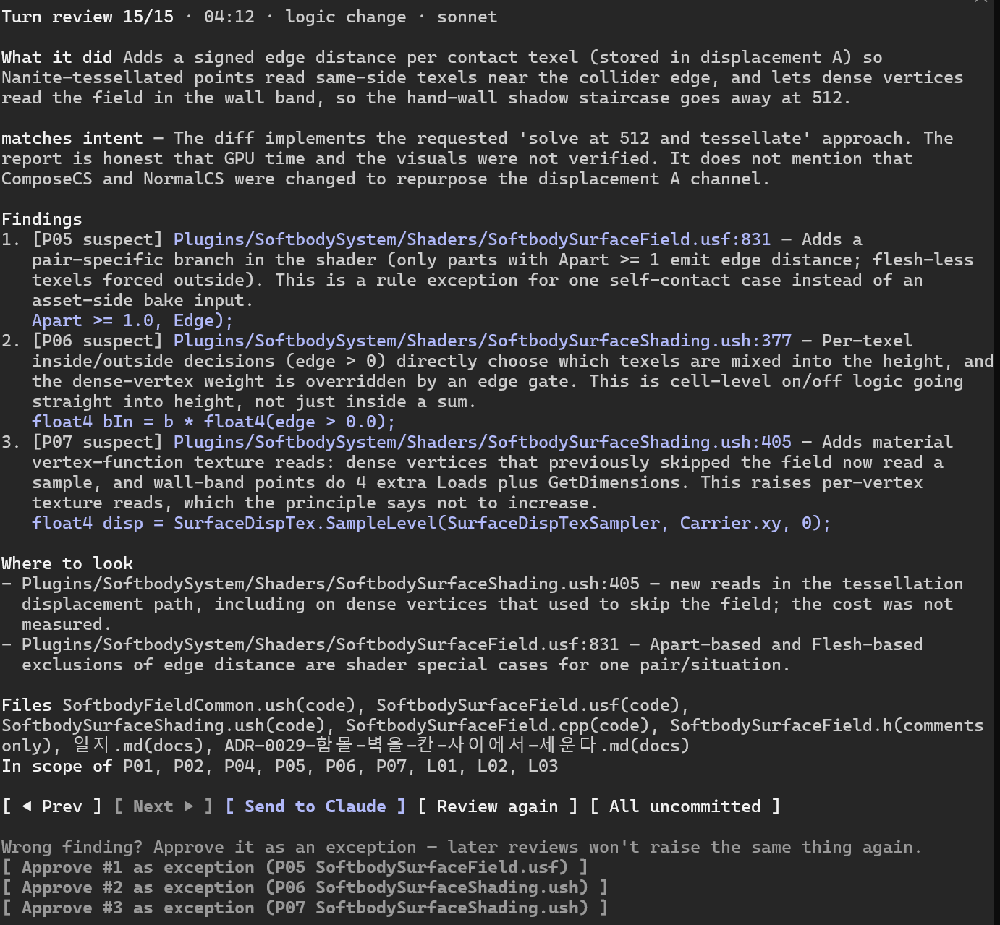

# Motive-mem

[English](README.md)

Claude Code 모드(mod). 턴이 끝날 때마다 그 턴에 바뀐 코드를 저장소의 `.claude/principles.md` 에 비춰, 코드를 쓴
Claude 와 다른 모델이 따로 리뷰한다. 한 줄씩 보는 코드 리뷰가 아니라 **의도**를 본다.

- 의도 일치 — diff 가 요청과 Claude 의 보고에 맞는가. 보고에 없는 변경, 부풀린 보고.
- 원칙 위반 — 저장소가 정해 둔 원칙(층, 한 길, "그 한 곳", 약속)을 어겼는가.
- 눈앞 땜질 — 국소 문제를 맞추려고 구조를 우회한 흔적(진입점 건너뛰기, 두 번째 사본, 테스트 기대값 바꾸기 …).



_턴이 끝난 뒤의 패널(`language: en`). `ko` 로 두면 한국어로 나온다._

착안: Anthropic 의 [Redesigning source control](https://www.anthropic.com/engineering/redesigning-source-control)
(Scion · Antique) — 사람은 줄이 아니라 의도를 검토하고, 반복되는 일은 에이전트가 대원칙을 깰 때 "아니"라고 하는 것.

> **비용:** 코드가 바뀐 턴마다 모델 호출이 한 번 더 사용자 계정에서 나간다(기본 `sonnet` · medium, 원칙 문서는
> 프롬프트 캐시). 주석·문서만 바뀐 턴은 건너뛰고, 원칙 파일이 없는 저장소에서는 아무것도 돌지 않는다.

## 동작

1. 메시지를 보내면 작업 트리를 `git stash create` 로 찍는다(작업 트리는 건드리지 않는다).
2. 답이 끝나면 다시 찍고 그 사이 diff 만 고른다. 주석·문서만 바뀌었으면 건너뛴다.
3. 별도 모델(기본 sonnet)에 원칙 · 요청 · Claude 의 마지막 보고 · diff 만 준다. 작성자의 추론은 주지 않는다.
4. 상태 줄과 토스트로 알리고, 지적이 있으면 패널을 연다 — **Claude에게 전달**, **다시 검토**, **예외 승인**.
   예외로 승인한 건은 `.git/motive-mem/decisions.jsonl` 에 남고 다음 리뷰부터 다시 짚지 않는다.

켜지는 조건은 둘 — 세션 폴더가 git 저장소 안이고, 그 저장소에 `.claude/principles.md` 가 있다. 사용자 범위로 깔아
두고 원칙 파일을 둔 저장소에서만 켜지게 쓴다.

## 설치

모드(플러그인 hooks 모듈)를 지원하는 Claude Code 가 필요하다. Claude Code 2.1.299 에서 만들고 시험했다 — 모드 API 는
얼리 액세스라 릴리스마다 바뀔 수 있다.

```sh
claude plugin marketplace add wjsekrud/motive-mem
claude plugin install motive-mem@motive-mem
```

화면 글과 리뷰 문장을 한국어로 보려면 설정에서 `language` 를 `ko` 로 바꾼다(기본은 `en`). 그다음 리뷰를 받을
저장소에서 `/motive-mem:principles` 로 원칙 파일을 만든다.

| 명령 | |
| --- | --- |
| `/motive-mem` | 패널 열기 |
| `/motive-mem all` | 커밋 안 한 변경 전체 검토 |
| `/motive-mem pause` · `resume` | 자동 리뷰 끄기 · 켜기 |
| `/motive-mem:principles` | 원칙 파일 만들기 · 손보기 (스킬) |

## 설정

`/plugin configure motive-mem@motive-mem`

| 설정 | 기본값 | |
| --- | --- | --- |
| `language` | `en` | 패널 · 상태 줄 · 리뷰 문장의 언어 — `en` 또는 `ko`. 원칙 파일은 어느 언어로 써도 된다. |
| `model` | `sonnet` | 리뷰 모델. 판단이 어려울수록 `opus` 가 낫고 비용은 더 든다. |
| `effort` | `medium` | 리뷰 모델이 얼마나 깊이 생각할지. |
| `maxDiffChars` | `60000` | 넘치면 코드 파일부터 넣고 나머지는 목록만 준다. |
| `openOnIssue` | `true` | 위반 · 의심 · 보고 밖 변경이 있으면 패널을 연다. |

## 원칙 파일

원칙은 짓지 않고 캐낸다 — CLAUDE.md · 설계 문서 · 코드와 검사의 docstring · 되돌린 기록에서 사람이 이미 정한
것을 찾아, 표로 보여 확인받은 뒤에 쓴다. 원칙이 불어나는 것 자체가 이 모드가 막으려는 드리프트라, 넣는 데는
근거가 필요하고 빼는 데는 근거가 틀렸다는 것만 있으면 된다. 한국어로 쓸 때는 필드 이름도 한국어(`- 범위:`,
`## 열린 질문` …)로 쓰면 된다. 기준과 절차는 [`skills/principles/SKILL.md`](skills/principles/SKILL.md), 형식은
[`skills/principles/references/format.md`](skills/principles/references/format.md).

## 한계

- 코드가 바뀐 턴마다 모델 호출 한 번.
- 원래 추적 안 되던 파일을 고친 것은 못 본다. 추적 안 되는 새 파일은 30개까지.
- git 이 작업 트리를 찍지 못한 턴(다른 git 명령이 index 잠금을 쥐고 있을 때, 병합 중, intent-to-add 항목)은 리뷰하지
  않고 상태 줄에 그렇게 알린다.
- 같은 계열 모델이 쓰고 리뷰하므로 사각지대가 겹칠 수 있다.
- 모드 API 는 얼리 액세스 — Claude Code 업데이트 뒤 모드가 안 뜨면 새 버전이 있는지 본다.

## 개발

[CLAUDE.md](CLAUDE.md) 참고. 복제본에서 돌리려면 폴더 자체를 마켓플레이스로 더한다 — 설치본이 그 폴더라 고치고
`/reload-plugins` 하면 반영된다.

```sh
claude plugin marketplace add /path/to/Motive-mem
claude plugin install motive-mem@motive-mem
```

## 라이선스

[MIT](LICENSE)
