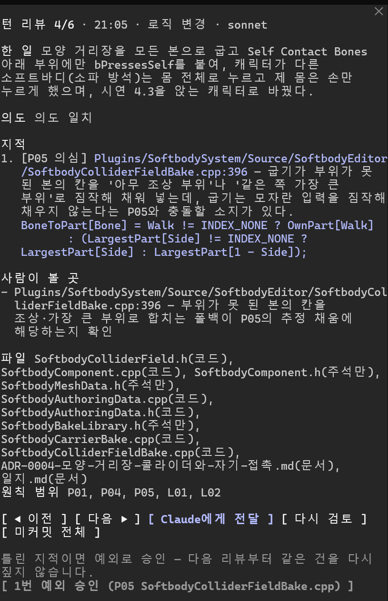

# Motive-mem

[한국어](README.ko.md)

A Claude Code mod that reviews **intent**, not lines. Each time a turn ends, a model other than the one that wrote
the code checks what that turn changed against your repository's `.claude/principles.md`.

- **Intent match** — does the diff match the request and Claude's report? Changes missing from the report, reports
  that claim more than happened.
- **Principle violations** — did it break a principle your repository has settled (layers, single paths, "the one
  place", promises)?
- **Band-aid fixes** — traces of routing around the structure to make a local problem go away (skipping the entry
  point, a second copy, changing test expectations …).



_The panel after a turn, shown with `language: ko`._

Inspired by Anthropic's [Redesigning source control](https://www.anthropic.com/engineering/redesigning-source-control)
(Scion · Antique) — people review intent rather than lines, and the recurring job is an agent saying "no" when a change
breaks a core principle.

> **Cost:** every turn that changes code makes one extra model call on your account (default `sonnet`, medium effort;
> the principles file is prompt-cached). Turns that touch only comments or docs are skipped, and in a repository
> without a principles file nothing runs at all.

## How it works

1. When you send a message, the working tree is snapshotted with `git stash create` (the tree itself is untouched).
2. When the answer ends, it snapshots again and takes only the diff in between. Comment- or docs-only changes are
   skipped.
3. A separate model (default sonnet) gets only the principles, the request, Claude's last report and the diff — never
   the author's reasoning.
4. The status line and a toast report the result; when there are findings, a panel opens with **Send to Claude**,
   **Review again** and **Approve as exception**. Approved exceptions are kept in `.git/motive-mem/decisions.jsonl` and
   are not raised again.

It turns on only when the session folder is inside a git repository that has `.claude/principles.md`. Install it at
user scope; it wakes up only where a principles file exists.

## Install

Requires Claude Code with mods (plugin hooks modules). Built and tested on Claude Code 2.1.299 — the mod API is early
access and may change between releases.

```sh
claude plugin marketplace add wjsekrud/motive-mem
claude plugin install motive-mem@motive-mem
```

Then, in a repository you want reviewed, create its principles file with `/motive-mem:principles`.

| Command | |
| --- | --- |
| `/motive-mem` | Open the panel |
| `/motive-mem all` | Review all uncommitted changes |
| `/motive-mem pause` · `resume` | Stop · restart automatic review |
| `/motive-mem:principles` | Create or revise the principles file (skill) |

## Settings

`/plugin configure motive-mem@motive-mem`

| Setting | Default | |
| --- | --- | --- |
| `language` | `en` | Panel, status line and review text — `en` or `ko`. Principles files can be in any language. |
| `model` | `sonnet` | The review model. `opus` judges hard cases better and costs more. |
| `effort` | `medium` | How hard the review model thinks. |
| `maxDiffChars` | `60000` | Past this, code files go in first and the rest are listed by name only. |
| `openOnIssue` | `true` | Open the panel when there is a violation, a suspect, or a change missing from the report. |

## The principles file

Principles are dug out, not invented. The skill finds what people already decided — in CLAUDE.md, design docs,
docstrings of code and tests, reverted history — shows it as a table for you to confirm, and only then writes the
file. A growing principles file is itself the drift this mode exists to stop, so adding a principle needs evidence and
removing one needs only that the evidence was wrong.

```markdown
## P02 Order status changes only in orders/transitions.py
- Scope: orders/**, api/handlers/**, jobs/**
- Rule: only `transitions.apply(order, event)` changes `Order.status` — the audit log and webhooks hang off it.
- Signal: `order.status =` outside `transitions.py`; loosening `test_status_only_changes_through_apply`.
- Evidence: ARCHITECTURE.md "State transitions"; the 2026-03 hotfix that refunded twice (reverted).
```

Criteria and procedure: [`skills/principles/SKILL.md`](skills/principles/SKILL.md). Format:
[`skills/principles/references/format.md`](skills/principles/references/format.md).

## Limitations

- One model call per turn that changes code.
- Edits to files that were never tracked are invisible; up to 30 new untracked files per turn.
- The same model family writes and reviews, so their blind spots can overlap.
- The mod API is early access — if the mod stops loading after a Claude Code update, check for a newer version.

## Development

See [CLAUDE.md](CLAUDE.md). To run from a clone, add the folder itself as a marketplace — the install is then the
folder, so edits apply after `/reload-plugins`:

```sh
claude plugin marketplace add /path/to/Motive-mem
claude plugin install motive-mem@motive-mem
```

## License

[MIT](LICENSE)
